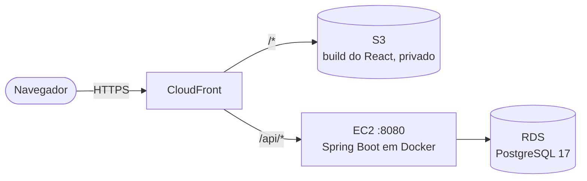
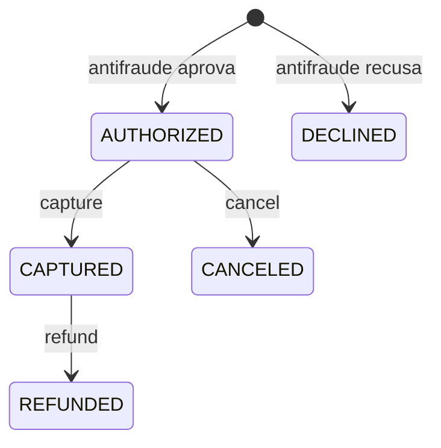

# Ponte

**Site:** https://d7wo0l0c3utlh.cloudfront.net

Gateway de pagamento simplificado, feito como projeto de portfólio. Um lojista se cadastra, recebe uma API key e cria cobranças de cartão, que passam por um antifraude e depois podem ser capturadas, canceladas ou estornadas. Não há banco nem adquirente de verdade: o foco está no que um gateway precisa garantir, como não cobrar duas vezes o mesmo pedido, não deixar operações simultâneas corromperem uma cobrança e não guardar dados sensíveis do cartão.

Embaixo de cada tela, um console mostra as requisições feitas à API e os logs do servidor ao vivo. No Laboratório dá para ver a idempotência e as capturas simultâneas acontecendo.

**Backend:** Java 21, Spring Boot 4, Spring Security, PostgreSQL 17, Flyway e Testcontainers.

**Front-end:** React 19 com Vite e CSS Modules, sem biblioteca de componentes.

**Infra:** AWS (CloudFront, S3, EC2 e RDS), com scripts em Bash.

## Arquitetura na AWS



- Front e API ficam no mesmo domínio, o do CloudFront, então não há CORS. O que começa com `/api` vai para a EC2, sem cache, e o resto vem do S3.
- O bucket é privado e só o CloudFront lê os arquivos. Uma CloudFront Function manda as rotas do React para o `index.html` sem mexer nas respostas da API.
- A EC2 só aceita tráfego do CloudFront, e o RDS só aceita conexões da EC2. Fora das demos, as duas ficam desligadas para não gastar.
- Os scripts ficam em `infra/`: `subir-api.sh` publica a API, `deploy-front.sh` publica o front, e `ligar.sh` e `desligar.sh` controlam a EC2 e o RDS.

## Estados de uma cobrança

Qualquer transição fora destas responde `409`:



## Decisões

- **Dinheiro em centavos.** Valores são `long`, nunca `double`, que não representa R$ 0,10 exatamente.
- **API key guardada só como hash.** A chave aparece uma única vez, no cadastro. O banco guarda o SHA-256 dela, comparado em tempo constante.
- **Nada do cartão que permita reconstruí-lo.** Ficam só os 4 últimos dígitos e um *fingerprint* HMAC, que deixa o antifraude reconhecer o cartão sem saber o número. O CVV é descartado.
- **Idempotência no banco.** Cada `Idempotency-Key` entra com um único `INSERT ... ON CONFLICT`, então dois pedidos simultâneos com a mesma chave nunca rodam os dois. Uma repetição recebe a resposta guardada.
- **Lock otimista.** De duas capturas simultâneas da mesma cobrança, só uma passa. A outra recebe `409`.
- **Regras de estado na entidade.** Só a `Charge` muda o próprio status, e ela recusa qualquer transição fora do diagrama acima.
- **`404` para a cobrança de outro lojista.** Um `403` confirmaria que ela existe.

## Como rodar

Precisa do Docker, do Java 21 e do Node.js 22. São três terminais:

```bash
docker compose up -d db

cd backend && ./mvnw spring-boot:run -Dspring-boot.run.profiles=demo

cd frontend && npm install && npm run dev
```

A interface abre em `http://localhost:5173` e o Swagger em `http://localhost:8080/api/swagger-ui.html`. A autenticação é pelo header `X-Api-Key`, e as rotas que criam ou alteram cobranças exigem `Idempotency-Key`.

- `./scripts/demo.sh http://localhost:8080/api` percorre o fluxo principal pelo terminal e confere cada resposta.
- Os testes rodam com `./mvnw test`, de dentro de `backend/`.
- Fora do ambiente local, defina `DB_URL`, `DB_USERNAME`, `DB_PASSWORD`, `CARD_FINGERPRINT_KEY` e `IDEMPOTENCY_HASH_KEY`.
- Para apresentar o projeto, há um [roteiro de demo de 5 minutos](docs/roteiro-demo.md).
