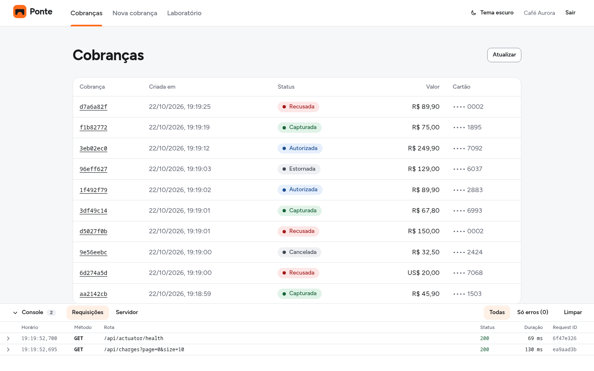
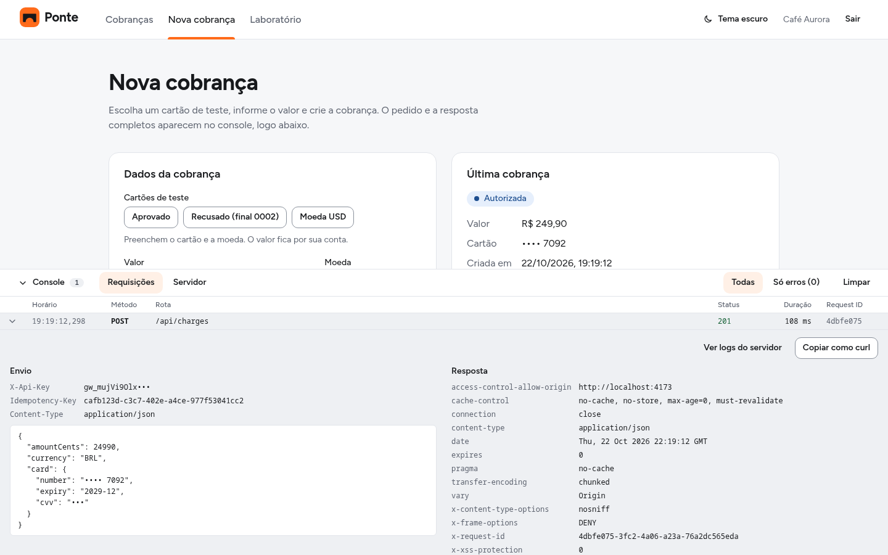
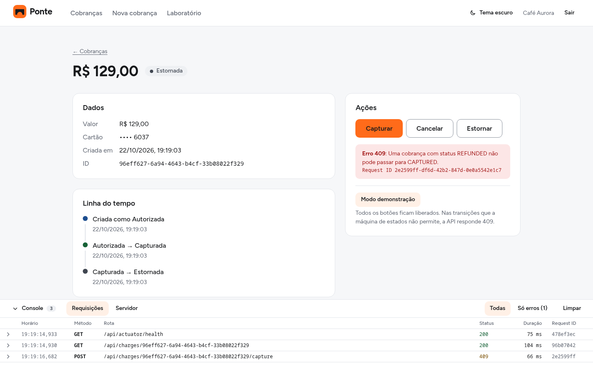
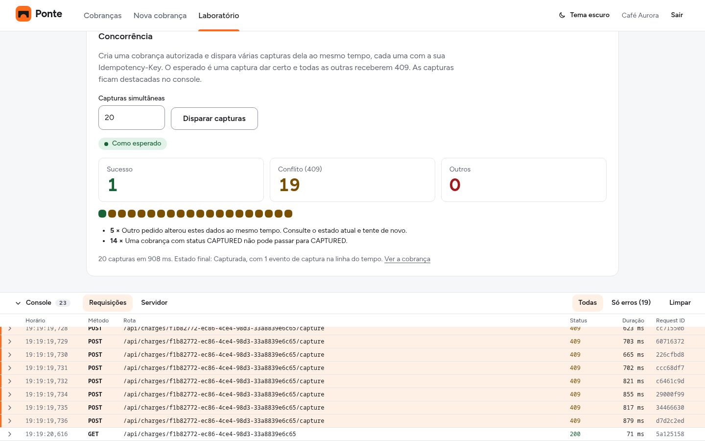
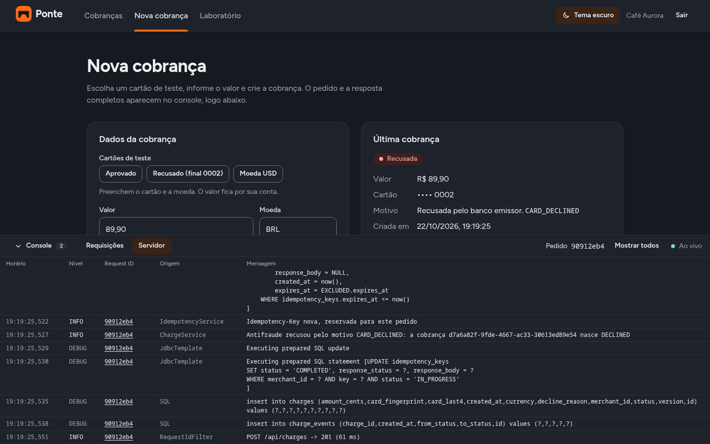
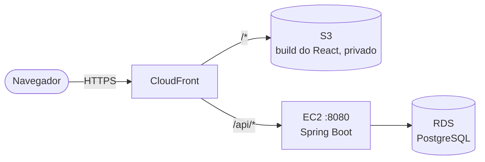
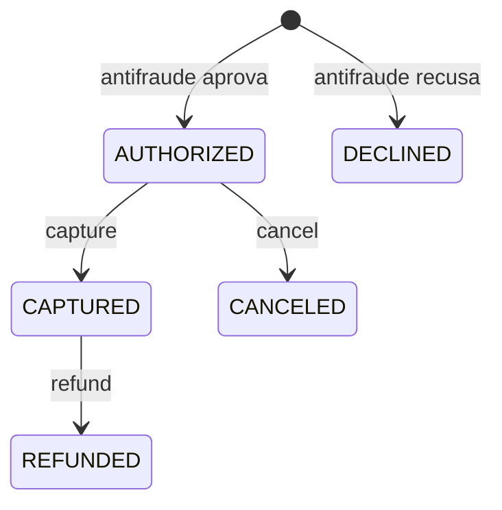

# Ponte

Gateway de pagamento simplificado, feito como projeto de portfólio: uma API REST e uma interface web que mostra, embaixo de cada tela, as requisições feitas à API e os logs do servidor ao vivo. Um lojista se cadastra, recebe uma API key e com ela cria cobranças de cartão, que passam por um antifraude e depois podem ser capturadas, canceladas ou estornadas.

Não há banco emissor nem adquirente de verdade: a aprovação ou a recusa vem das regras de antifraude da própria API. O foco está no que um gateway real precisa garantir: não cobrar duas vezes o mesmo pedido, não deixar duas operações simultâneas corromperem uma cobrança e não guardar dados sensíveis do cartão.

**Backend:** Java 21, Spring Boot 4, Spring Security, Spring Data JPA, PostgreSQL 17, Flyway, springdoc-openapi, Testcontainers e Docker.

**Front-end:** React 19 com Vite, em JavaScript, React Router e CSS Modules. Sem biblioteca de componentes: os componentes base e os tokens de cor, espaçamento e tipografia são do próprio projeto.



## Telas

**Nova cobrança.** Os botões de cartão de teste preenchem o cartão e a moeda para três resultados: aprovado, recusado pelo final `0002` e recusado por ser em dólar. No console, o detalhe do pedido mostra a `Idempotency-Key` gerada pelo front, e a API key e o cartão aparecem mascarados.



**Detalhe da cobrança.** A linha do tempo mostra cada mudança de estado. Os botões só ficam habilitados nas transições válidas, mas o modo demonstração libera todos para mostrar a API recusando uma transição inválida com `409`.



**Laboratório de garantias.** Dois experimentos que põem as garantias da API à prova pelo navegador. Na concorrência, 20 capturas da mesma cobrança saem ao mesmo tempo: uma passa e 19 recebem `409`, umas barradas pelo lock otimista e outras pela máquina de estados.



**Logs do servidor.** A aba Servidor do console recebe ao vivo os logs dos pedidos do lojista. Clicar em "Ver logs do servidor" numa requisição filtra as linhas pelo request ID dela: a chave de idempotência reservada, o antifraude decidindo e o SQL executado.



## Arquitetura alvo

O deploy na AWS está em andamento. Esta é a arquitetura que ele vai ter:



- Front e API ficam no mesmo domínio, o do CloudFront. Por isso não há CORS nem mistura de HTTP com HTTPS, e todas as rotas da API ficam sob `/api` para o CloudFront saber para onde mandar cada pedido.
- Em desenvolvimento, o Vite faz o mesmo papel: serve o front e repassa o que começa com `/api` para `localhost:8080`.
- A EC2 só aceita tráfego vindo do CloudFront, e o RDS só aceita conexões vindas da EC2.

## Endpoints

| Método | Rota | Autenticação | `Idempotency-Key` | O que faz |
|---|---|---|---|---|
| `POST` | `/api/merchants` | não | não | Cadastra o lojista e devolve a API key, uma única vez |
| `GET` | `/api/merchants/me` | sim | não | Dados do lojista autenticado |
| `POST` | `/api/charges` | sim | obrigatória | Cria a cobrança, que já nasce `AUTHORIZED` ou `DECLINED` |
| `GET` | `/api/charges` | sim | não | Lista as cobranças do lojista, das mais recentes para as mais antigas, em páginas (`page` a partir de 0 e `size` de 1 a 100) |
| `GET` | `/api/charges/{id}` | sim | não | Consulta a cobrança com o histórico de estados |
| `POST` | `/api/charges/{id}/capture` | sim | obrigatória | Captura uma cobrança autorizada |
| `POST` | `/api/charges/{id}/cancel` | sim | obrigatória | Cancela uma cobrança autorizada |
| `POST` | `/api/charges/{id}/refund` | sim | obrigatória | Estorna uma cobrança capturada |
| `GET` | `/api/dev/logs` | sim | não | Logs dos pedidos do próprio lojista, ao vivo por Server-Sent Events. Só existe com o profile `demo` |

A autenticação é pelo header `X-Api-Key`. A documentação interativa fica em `/api/swagger-ui.html`, com o botão *Authorize* para informar a chave.

Toda resposta traz o header `X-Request-Id`, e o mesmo valor aparece nas linhas de log daquele pedido, junto com o id do lojista. Se o pedido já chegar com esse header, a API reaproveita o valor, desde que tenha até 64 caracteres entre letras, dígitos, `-`, `.` e `_`. Fora disso, ela gera um novo.

## Diagramas

O caminho de um pedido de cobrança pela aplicação:


Os estados de uma cobrança. Qualquer transição fora destas responde `409`:



## Como rodar

### Interface e API

Precisa do Docker, do Java 21 e do Node.js 22 (ou 20.19 em diante). São três terminais: o banco, a API e o front.

```bash
# 1. Banco
docker compose up -d db

# 2. API, com o profile demo para a aba Servidor do console funcionar
cd backend
./mvnw spring-boot:run -Dspring-boot.run.profiles=demo

# 3. Front
cd frontend
npm install
npm run dev
```

A interface abre em `http://localhost:5173`. Para conferir o build de produção, use `npm run build` e depois `npm run preview`, que abre em `http://localhost:4173` com o mesmo repasse de `/api`.

Para apresentar o projeto pela interface, há um [roteiro de demo de 5 minutos](docs/roteiro-demo.md).

### Só a API, com Docker

Um comando sobe o banco e a API:

```bash
docker compose up --build
```

A API fica em `http://localhost:8080/api` e o Swagger em `http://localhost:8080/api/swagger-ui.html`. O front também funciona com ela, mas sem o profile `demo` a aba Servidor do console fica indisponível.

### Demo pelo terminal

Com a API no ar, o script abaixo percorre o fluxo principal com `curl`: cadastro, cobrança aprovada, repetição idempotente, cobrança recusada, captura, estorno e isolamento entre lojistas. Ele confere a resposta de cada passo e para no primeiro que não sair como esperado.

```bash
./scripts/demo.sh http://localhost:8080/api
```

### Logs ao vivo (profile `demo`)

Com o profile `demo`, a API guarda em memória as últimas 200 linhas de log de cada lojista e as transmite ao vivo, junto com o SQL que cada pedido executou, com `?` no lugar dos valores. Dá para ver a idempotência reservando a chave, o antifraude decidindo e o lock otimista barrando uma captura simultânea. Cada lojista recebe só as linhas dos próprios pedidos.

A aba Servidor do console mostra esse stream. Pelo terminal, também dá para acompanhar:

```bash
curl -N http://localhost:8080/api/dev/logs -H "X-Api-Key: <chave>"
```

### Testes e verificações

Os testes do backend rodam com `./mvnw test`, de dentro de `backend/`. Os testes de idempotência e de concorrência sobem um PostgreSQL próprio com Testcontainers e só precisam do Docker rodando. O teste que apenas confere se a aplicação inicia ainda usa o banco do `docker compose`, então ele precisa estar de pé.

No front, `npm run lint` roda o ESLint e `npm run build` gera o build de produção em `frontend/dist`.

### Variáveis de ambiente

| Variável | Para que serve |
|---|---|
| `DB_URL`, `DB_USERNAME`, `DB_PASSWORD` | Conexão com o PostgreSQL |
| `CARD_FINGERPRINT_KEY` | Chave do HMAC que identifica um cartão sem guardar o número |
| `IDEMPOTENCY_HASH_KEY` | Chave do HMAC que identifica o conteúdo de um pedido idempotente |

Todas têm valores padrão que só servem para rodar localmente. Em qualquer outro ambiente, precisam ser definidas.

## Decisões

- **Dinheiro em centavos.** Valores são `long` no Java e `bigint` no banco. Com `double`, R$ 0,10 + R$ 0,20 não daria exatamente R$ 0,30.
- **API key guardada só como hash.** A chave completa aparece uma única vez, na resposta do cadastro. O banco guarda o prefixo, usado para encontrar a chave, e o SHA-256 dela, comparado em tempo constante. Se o banco vazar, as chaves continuam seguras.
- **Nada do cartão que permita reconstruí-lo.** Ficam só os 4 últimos dígitos e um *fingerprint* HMAC-SHA256, com uma chave secreta da aplicação, que deixa o antifraude reconhecer o mesmo cartão sem saber o número. O CVV é validado e descartado.
- **Regras de estado dentro da entidade.** A `Charge` decide sozinha se uma transição é válida e registra o evento no histórico. Os controllers e services não mexem no status diretamente.
- **Idempotência no banco.** Cada `Idempotency-Key` é registrada por lojista com um único `INSERT ... ON CONFLICT`, então dois pedidos simultâneos com a mesma chave nunca são executados os dois. O pedido é identificado por um HMAC de método, rota e corpo. Uma repetição igual recebe a resposta guardada, uma repetição com conteúdo diferente recebe `422`, e uma chave ainda em andamento recebe `409`. As chaves valem por 24 horas.
- **Lock otimista contra operações simultâneas.** A `Charge` tem `@Version`, e o Hibernate só grava se a versão não mudou desde a leitura. De duas capturas simultâneas da mesma cobrança, uma passa e a outra recebe `409`.
- **Open Session In View desligado.** Ligado, que é o padrão do Spring Boot, cada requisição segura a conexão com o banco até o fim, e com muitas falhas simultâneas o pool de conexões trava. Tudo o que vem do banco é convertido em DTO ainda dentro da transação.
- **`404` para a cobrança de outro lojista.** Um `403` confirmaria que o id existe. Com `404`, ela é indistinguível de uma cobrança inexistente.
- **Antifraude em regras independentes.** Cada regra implementa `FraudRule` e o `FraudService` aplica todas em ordem, parando na primeira recusa. São quatro: moeda diferente de BRL, cartão de teste com final `0002`, valor acima de R$ 10.000,00 e, a partir da quarta, cobranças do mesmo cartão em menos de cinco minutos.
- **Erros no formato Problem Details (RFC 9457).** Todo erro tem a mesma estrutura, inclusive os de validação, que listam os campos inválidos.
- **Schema versionado com Flyway.** As migrations criam e alteram as tabelas. O Hibernate só valida se as entidades batem com o banco e impede a aplicação de subir se não baterem.

## Próximos passos

- **Deploy na AWS**, seguindo a [arquitetura alvo](#arquitetura-alvo), com o HTTPS do CloudFront e scripts para ligar e desligar tudo e não pagar pelo tempo parado.
- **Limpeza periódica** das chaves de idempotência expiradas, que hoje só são reaproveitadas quando a mesma chave volta.
- **Webhooks** para avisar o lojista quando uma cobrança muda de estado.
- **Captura e estorno parciais**, que hoje sempre usam o valor inteiro da cobrança.
- **Limite de requisições** por API key.
