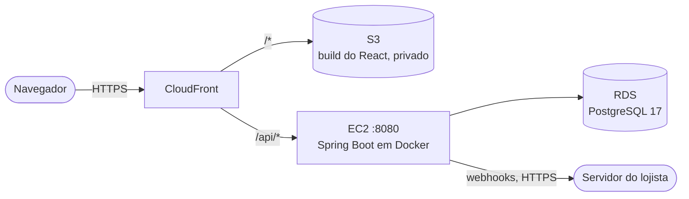
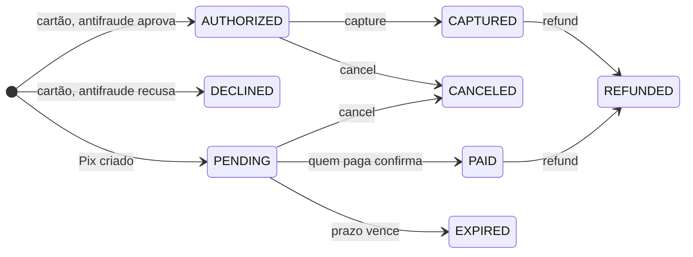
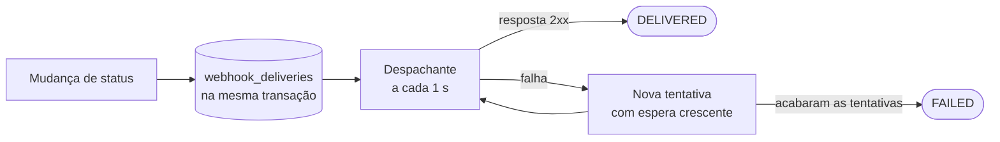

# Ponte

**Site:** https://d7wo0l0c3utlh.cloudfront.net

Gateway de pagamento simplificado. Um lojista se cadastra, recebe uma API key e cria cobranças de cartão ou Pix. As de cartão passam por um antifraude e depois podem ser capturadas, canceladas ou estornadas. As de Pix ficam pendentes até alguém pagar ou o prazo vencer. A cada mudança de status, o gateway avisa o lojista por webhook e, se o servidor dele estiver fora do ar, tenta de novo mais tarde.

Não há banco nem adquirente de verdade: o foco está no que um gateway precisa garantir, como não cobrar duas vezes o mesmo pedido, não deixar operações simultâneas corromperem uma cobrança, não guardar dados sensíveis do cartão e não perder o aviso de uma mudança de status.

Embaixo de cada tela, um console mostra as requisições feitas à API e os logs do servidor ao vivo. No Laboratório dá para ver a idempotência, as capturas simultâneas e a entrega garantida de webhooks acontecendo.

**Backend:** Java 21, Spring Boot 4, Spring Security, PostgreSQL 17, Flyway e Testcontainers.

**Front-end:** React 19 com Vite e CSS Modules, sem biblioteca de componentes.

**Infra:** AWS (CloudFront, S3, EC2 e RDS), com scripts em Bash.

## Arquitetura na AWS



- Front e API ficam no mesmo domínio, o do CloudFront, então não há CORS. O que começa com `/api` vai para a EC2, sem cache, e o resto vem do S3.
- O bucket é privado e só o CloudFront lê os arquivos. Uma CloudFront Function manda as rotas do React para o `index.html` sem mexer nas respostas da API.
- A EC2 só aceita tráfego do CloudFront, e o RDS só aceita conexões da EC2. Fora das demos, as duas ficam desligadas para não gastar.
- O despachante de webhooks e a expiração do Pix rodam dentro da própria API, sem serviço à parte. Os webhooks fazem a EC2 chamar endereços escolhidos pelo lojista, e por isso toda URL passa pela proteção contra SSRF descrita nas decisões.
- Os scripts ficam em `infra/`: `subir-api.sh` publica a API, `deploy-front.sh` publica o front, e `ligar.sh` e `desligar.sh` controlam a EC2 e o RDS.

## Estados de uma cobrança

Qualquer transição fora destas responde `409`:



O Pix não passa pelo antifraude, cujas regras dependem do cartão, e só aceita BRL. O prazo é de 15 minutos, a não ser que o pedido informe outro.

## Caminho de um webhook



- Cada status gera um evento `charge.<status>`, como `charge.paid`. O corpo traz `type`, `createdAt` e, em `data`, a cobrança no mesmo formato de `GET /charges/{id}`.
- Cada envio leva `Ponte-Event-Id` e `Ponte-Signature: t=<timestamp>,v1=<HMAC-SHA256 de "timestamp.corpo">`, para o lojista conferir que veio do gateway.
- São até 6 tentativas, com esperas de 1 min, 5 min, 30 min, 2 h e 6 h. No profile `demo`, as esperas caem para 5 s, 15 s, 30 s, 1 min e 2 min, para dar tempo de ver acontecendo. Depois da última, a entrega fica `FAILED` e continua visível em `GET /webhook-deliveries`.
- O mesmo evento pode chegar duas vezes, por exemplo se a resposta do lojista se perder no caminho. O `Ponte-Event-Id` é igual em todas as tentativas, e é por ele que o lojista reconhece o que já processou.

## Decisões

- **Dinheiro em centavos.** Valores são `long`, nunca `double`, que não representa R$ 0,10 exatamente.
- **API key guardada só como hash.** A chave aparece uma única vez, no cadastro. O banco guarda o SHA-256 dela, comparado em tempo constante.
- **Nada do cartão que permita reconstruí-lo.** Ficam só os 4 últimos dígitos e um *fingerprint* HMAC, que deixa o antifraude reconhecer o cartão sem saber o número. O CVV é descartado.
- **Idempotência no banco.** Cada `Idempotency-Key` entra com um único `INSERT ... ON CONFLICT`, então dois pedidos simultâneos com a mesma chave nunca rodam os dois. Uma repetição recebe a resposta guardada.
- **Lock otimista.** De duas capturas simultâneas da mesma cobrança, só uma passa. A outra recebe `409`.
- **Regras de estado na entidade.** Só a `Charge` muda o próprio status, e ela recusa qualquer transição fora do diagrama acima.
- **`404` para a cobrança de outro lojista.** Um `403` confirmaria que ela existe.
- **Outbox na mesma transação.** A entrega do webhook é gravada na transação que muda o status: ou as duas ficam, ou nenhuma. Enviar logo depois do commit perderia o aviso se a API caísse entre um passo e outro.
- **`SKIP LOCKED` no despachante.** Cada entrega é buscada com `FOR UPDATE SKIP LOCKED`, e a trava dura até o fim do envio. Com mais de uma instância da API, nenhuma pega a entrega de outra, e nenhuma fica parada esperando.
- **Assinatura com timestamp.** O HMAC cobre o timestamp junto com o corpo. Assim, quem capturar um webhook não consegue reenviá-lo mais tarde, porque o lojista recusa assinaturas com mais de 5 minutos, como faz o receptor de teste do projeto.
- **Segredo de assinatura derivado, não gravado.** O segredo de cada lojista é um HMAC do id do endpoint com a `WEBHOOK_SIGNING_KEY`, recalculado quando preciso. Um vazamento do banco não entrega os segredos. Em troca, mudar essa chave muda o segredo de todos os lojistas de uma vez.
- **Proteção contra SSRF.** A URL do webhook precisa ser `https`, sem usuário e senha, e o host precisa resolver só para IPs públicos, o que deixa de fora a rede interna e o serviço de metadados da EC2. A validação olha os endereços resolvidos, não o texto da URL, e acontece no cadastro e de novo a cada envio. O envio não segue redirecionamentos, e da resposta fica só o status, nunca o corpo. Sobra uma janela curta entre validar e conectar, em que o DNS ainda pode mudar. Fechá-la exigiria fixar o IP validado na conexão.
- **Prazo do Pix conferido na entidade.** A `Charge` confere o prazo tanto para pagar quanto para expirar, com a mesma conta, então cada instante permite só um dos dois. Pagar depois do prazo dá `409` mesmo que o job de expiração, que roda a cada 10 segundos, ainda não tenha passado. Se os dois chegarem juntos, o lock otimista deixa valer só um, com um único webhook.

## Como rodar

Precisa do Docker, do Java 21 e do Node.js 22. São três terminais:

```bash
docker compose up -d db

cd backend && ./mvnw spring-boot:run -Dspring-boot.run.profiles=demo

cd frontend && npm install && npm run dev
```

A interface abre em `http://localhost:5173` e o Swagger em `http://localhost:8080/api/swagger-ui.html`. A autenticação é pelo header `X-Api-Key`, e as rotas que criam ou alteram cobranças exigem `Idempotency-Key`.

- `./scripts/demo.sh http://localhost:8080/api` percorre o fluxo principal pelo terminal e confere cada resposta.
- Os testes rodam com `./mvnw test`, de dentro de `backend/`.
- Fora do ambiente local, defina `DB_URL`, `DB_USERNAME`, `DB_PASSWORD`, `CARD_FINGERPRINT_KEY`, `IDEMPOTENCY_HASH_KEY` e `WEBHOOK_SIGNING_KEY`. Na AWS, os segredos vêm do Parameter Store.
- O simulador de pagamento do Pix (`/dev/pix`) e o receptor de teste de webhooks só existem no profile `demo`. A página `/pix/:id` usa o simulador, sem API key: como num QR code de Pix, quem tem o link consegue pagar.
- O QR code leva o endereço da própria página. Para escanear com o celular na mesma rede, rode `npm run dev -- --host` e abra o front pelo IP da máquina, e não por `localhost`.
- Para apresentar o projeto, há um [roteiro de demo de 5 minutos](docs/roteiro-demo.md).
