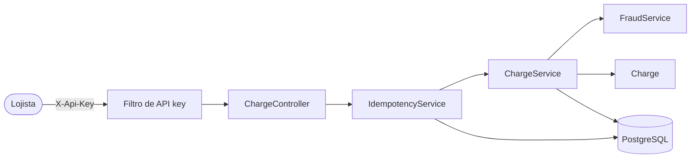
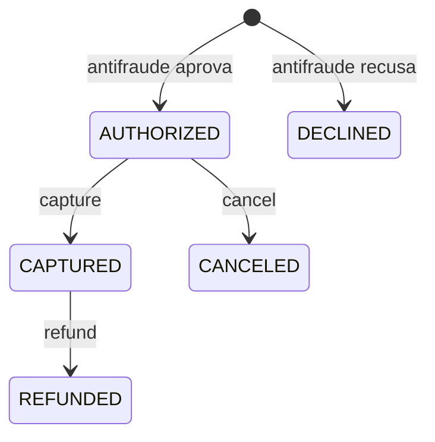

# Gateway de Pagamento

API REST de um gateway de pagamento simplificado, feita como projeto de portfólio. Um lojista se cadastra, recebe uma API key e com ela cria cobranças de cartão, que passam por um antifraude e depois podem ser capturadas, canceladas ou estornadas.

Não há banco emissor nem adquirente de verdade: a aprovação ou a recusa vem das regras de antifraude da própria API. O foco está no que um gateway real precisa garantir: não cobrar duas vezes o mesmo pedido, não deixar duas operações simultâneas corromperem uma cobrança e não guardar dados sensíveis do cartão.

**Stack:** Java 21, Spring Boot 4, Spring Security, Spring Data JPA, PostgreSQL 17, Flyway, springdoc-openapi, Testcontainers e Docker.

## Endpoints

| Método | Rota | Autenticação | `Idempotency-Key` | O que faz |
|---|---|---|---|---|
| `POST` | `/api/merchants` | não | não | Cadastra o lojista e devolve a API key, uma única vez |
| `GET` | `/api/merchants/me` | sim | não | Dados do lojista autenticado |
| `POST` | `/api/charges` | sim | obrigatória | Cria a cobrança, que já nasce `AUTHORIZED` ou `DECLINED` |
| `GET` | `/api/charges` | sim | não | Lista as cobranças do lojista, das mais recentes para as mais antigas, em páginas (`page` a partir de 0 e `size` de 1 a 100) |
| `GET` | `/api/charges/{id}` | sim | não | Consulta a cobrança com o histórico de estados |
| `POST` | `/api/charges/{id}/capture` | sim | obrigatória | Captura uma cobrança autorizada |
| `POST` | `/api/charges/{id}/cancel` | sim | obrigatória | Cancela uma cobrança autorizada |
| `POST` | `/api/charges/{id}/refund` | sim | obrigatória | Estorna uma cobrança capturada |

A autenticação é pelo header `X-Api-Key`. A documentação interativa fica em `/api/swagger-ui.html`, com o botão *Authorize* para informar a chave.

## Diagramas

O caminho de um pedido de cobrança pela aplicação:



Os estados de uma cobrança. Qualquer transição fora destas responde `409`:



## Como rodar

Com Docker, um comando sobe o banco e a API:

```bash
docker compose up --build
```

A API fica em `http://localhost:8080/api` e o Swagger em `http://localhost:8080/api/swagger-ui.html`.

### Demo

Com a API no ar, o script abaixo percorre o fluxo principal com `curl`: cadastro, cobrança aprovada, repetição idempotente, cobrança recusada, captura, estorno e isolamento entre lojistas. Ele confere a resposta de cada passo e para no primeiro que não sair como esperado.

```bash
./scripts/demo.sh http://localhost:8080/api
```

### Desenvolvimento

Para rodar a aplicação fora do Docker, suba só o banco e use o Maven Wrapper, que já vem no projeto (precisa do Java 21):

```bash
docker compose up -d db
cd backend
./mvnw spring-boot:run
```

Os testes rodam com `./mvnw test`, de dentro de `backend/`. Os testes de idempotência e de concorrência sobem um PostgreSQL próprio com Testcontainers e só precisam do Docker rodando. O teste que apenas confere se a aplicação inicia ainda usa o banco do `docker compose`, então ele precisa estar de pé.

### Variáveis de ambiente

| Variável | Para que serve |
|---|---|
| `DB_URL`, `DB_USERNAME`, `DB_PASSWORD` | Conexão com o PostgreSQL |
| `CARD_FINGERPRINT_KEY` | Chave do HMAC que identifica um cartão sem guardar o número |
| `IDEMPOTENCY_HASH_KEY` | Chave do HMAC que identifica o conteúdo de um pedido idempotente |

Todas têm valores padrão que só servem para rodar localmente. Em qualquer outro ambiente, precisam ser definidas.

## Decisões

- **Dinheiro em centavos.** Valores são `long` no Java e `bigint` no banco. Com `double`, R$ 0,10 + R$ 0,20 não daria exatamente R$ 0,30.
- **API key guardada só como hash.** A chave completa aparece uma única vez, na resposta do cadastro. O banco guarda o prefixo, usado para encontrar a chave, e o SHA-256 dela, comparado em tempo constante. Se o banco vazar, as chaves continuam seguras.
- **Nada do cartão que permita reconstruí-lo.** Ficam só os 4 últimos dígitos e um *fingerprint* HMAC-SHA256, com uma chave secreta da aplicação, que deixa o antifraude reconhecer o mesmo cartão sem saber o número. O CVV é validado e descartado.
- **Regras de estado dentro da entidade.** A `Charge` decide sozinha se uma transição é válida e registra o evento no histórico. Os controllers e services não mexem no status diretamente.
- **Idempotência no banco.** Cada `Idempotency-Key` é registrada por lojista com um único `INSERT ... ON CONFLICT`, então dois pedidos simultâneos com a mesma chave nunca são executados os dois. O pedido é identificado por um HMAC de método, rota e corpo. Uma repetição igual recebe a resposta guardada, uma repetição com conteúdo diferente recebe `422`, e uma chave ainda em andamento recebe `409`. As chaves valem por 24 horas.
- **Lock otimista contra operações simultâneas.** A `Charge` tem `@Version`, e o Hibernate só grava se a versão não mudou desde a leitura. De duas capturas simultâneas da mesma cobrança, uma passa e a outra recebe `409`.
- **Open Session In View desligado.** Ligado, que é o padrão do Spring Boot, cada requisição segura a conexão com o banco até o fim, e com muitas falhas simultâneas o pool de conexões trava. Tudo o que vem do banco é convertido em DTO ainda dentro da transação.
- **`404` para a cobrança de outro lojista.** Um `403` confirmaria que o id existe. Com `404`, ela é indistinguível de uma cobrança inexistente.
- **Antifraude em regras independentes.** Cada regra implementa `FraudRule` e o `FraudService` aplica todas em ordem, parando na primeira recusa. São quatro: moeda diferente de BRL, cartão de teste com final `0002`, valor acima de R$ 10.000,00 e, a partir da quarta, cobranças do mesmo cartão em menos de cinco minutos.
- **Erros no formato Problem Details (RFC 9457).** Todo erro tem a mesma estrutura, inclusive os de validação, que listam os campos inválidos.
- **Schema versionado com Flyway.** As migrations criam e alteram as tabelas. O Hibernate só valida se as entidades batem com o banco e impede a aplicação de subir se não baterem.

## Próximos passos

- **Deploy na AWS:** a API numa EC2 e o banco num RDS PostgreSQL, com Security Groups que só deixam a EC2 falar com o banco, e scripts para ligar e desligar tudo e não pagar pelo tempo parado.
- **HTTPS** na frente da API.
- **Limpeza periódica** das chaves de idempotência expiradas, que hoje só são reaproveitadas quando a mesma chave volta.
- **Webhooks** para avisar o lojista quando uma cobrança muda de estado.
- **Captura e estorno parciais**, que hoje sempre usam o valor inteiro da cobrança.
- **Limite de requisições** por API key.
